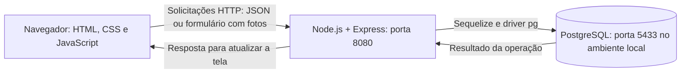

# Guia de apresentação do AutoCar — CRUDs do Clemer

Este guia descreve o código atual do projeto em `/home/clemer/AutoCar`. Os dois CRUDs atribuídos ao Clemer são **Usuários** e **Veículos**. CRUD significa criar, consultar, atualizar e excluir registros.

## 1. Como apresentar a ideia do projeto

> O AutoCar é um sistema de gerenciamento de veículos e usuários. A interface é feita com HTML, CSS e JavaScript. O servidor usa Node.js com Express, e os dados ficam no PostgreSQL. O Sequelize faz a comunicação entre o código JavaScript do servidor e as tabelas do banco. Fiquei responsável pelos módulos de Usuários e Veículos.

Na implementação, foi utilizada a referência `desenvweb2026` para o padrão de autenticação com Express, Sequelize/PostgreSQL, bcrypt e JWT. Na cópia atual, essa pasta de referência não está presente; a aplicação funciona com os arquivos da própria raiz do AutoCar. O visual foi orientado pelo PDF em `/home/clemer/AutoCar/docs/wireframes/WireFrame_AutoCar.pdf`.

A estrutura foi desenvolvida por etapas: preparação do servidor e banco, autenticação, telas do modelo visual, CRUDs de Usuários e Veículos, cadastro público, dashboard com dados reais e perfil/configurações. Depois foram integrados os CRUDs de Marcas, Categorias, Serviços e Vendas. Os dois módulos sob responsabilidade do Clemer continuam sendo Usuários e Veículos.

## 2. Como as três partes se conectam



- **Frontend:** apresenta telas, recebe os campos digitados, envia solicitações e mostra respostas.
- **Backend:** confere quem está acessando, aplica as regras e executa operações no banco.
- **Banco:** mantém os dados mesmo depois de fechar a página ou reiniciar o Node.js.

O navegador não recebe a senha de conexão do PostgreSQL. Ele conversa com a API do backend. A API é o conjunto de endereços que o frontend utiliza para pedir operações ao servidor.

O Express serve tanto os arquivos do frontend quanto a API. Por isso, basta iniciar um servidor Node.js para acessar o site.

## 3. Pastas e arquivos da raiz

| Local | Função no projeto |
|---|---|
| `/home/clemer/AutoCar/frontend` | Telas, aparência e JavaScript executado no navegador. |
| `/home/clemer/AutoCar/backend` | Servidor, autenticação, validações e acesso ao banco. |
| `/home/clemer/AutoCar/database` | SQL que prepara a estrutura das tabelas. |
| `/home/clemer/AutoCar/docs` | Documentação, modelos visuais e referências. |
| `/home/clemer/AutoCar/tests` | Testes automatizados das funcionalidades e permissões. |
| `/home/clemer/AutoCar/node_modules` | Bibliotecas instaladas pelo npm; não é código autoral do projeto. |
| `/home/clemer/AutoCar/.local` | Dados locais de desenvolvimento: PostgreSQL e imagens enviadas. |
| `/home/clemer/AutoCar/.git` | Histórico e configurações do Git. |

Arquivos importantes da raiz:

- [package.json](/home/clemer/AutoCar/package.json): disponibiliza os comandos npm e encaminha sua execução ao backend por meio de um workspace.
- [package-lock.json](/home/clemer/AutoCar/package-lock.json): registra as versões das dependências para instalações consistentes.
- [README.md](/home/clemer/AutoCar/README.md): explica instalação, execução e funcionalidades.
- [.gitignore](/home/clemer/AutoCar/.gitignore): exclui do Git dependências, configurações privadas, dados locais e a pasta de referência.
- [AGENTS.md](/home/clemer/AutoCar/AGENTS.md): registra as orientações de trabalho no projeto; não é executado pelo site.

O arquivo avulso chamado `de usuários e veículos"` contém uma saída de terminal e não faz parte do funcionamento do sistema.

## 4. O que existe no frontend

| Pasta | O que faz |
|---|---|
| `/home/clemer/AutoCar/frontend/pages` | Páginas públicas: login, cadastro e a área simples da conta de cliente. |
| `/home/clemer/AutoCar/frontend/pages/admin` | Dashboard, listagens/formulários de Usuários e Veículos, perfil e configurações. |
| `/home/clemer/AutoCar/frontend/js` | Login, cadastro, sessão, tema e caixas de informação. |
| `/home/clemer/AutoCar/frontend/js/admin` | Comportamento das telas administrativas e dos dois CRUDs. |
| `/home/clemer/AutoCar/frontend/css` | Aparência: estilos gerais, formulários, dashboard, CRUDs, conta e temas. |
| `/home/clemer/AutoCar/frontend/assets/fonts` | Fontes locais e suas licenças. |
| `/home/clemer/AutoCar/frontend/assets/images` | Ícones, imagem do login e recursos visuais. As subpastas organizam ícones, login e veículos; também existe uma pasta reservada para logo. |

Arquivos compartilhados que vale conhecer:

- [auth.js](/home/clemer/AutoCar/frontend/js/auth.js): usa `fetch` para chamar a API, inclui o token na solicitação e trata respostas/erros.
- [common.js](/home/clemer/AutoCar/frontend/js/admin/common.js): verifica a sessão administrativa, mostra a identificação da conta e reúne funções de formatação e interface.
- [list.js](/home/clemer/AutoCar/frontend/js/admin/list.js): compartilha busca, filtros, paginação, ações de ver/editar e confirmação de exclusão entre os CRUDs.
- [navigation.js](/home/clemer/AutoCar/frontend/js/admin/navigation.js): monta o mesmo menu em todas as telas administrativas.
- [theme.js](/home/clemer/AutoCar/frontend/js/theme.js) e [theme.css](/home/clemer/AutoCar/frontend/css/theme.css): aplicam os temas claro e escuro. A preferência é salva no navegador.

Os arquivos de CSS como `cards.css`, `header.css`, `sidebar.css` e `tables.css` estão vazios na versão atual. Os estilos em uso estão principalmente nos arquivos gerais, de dashboard, de formulários e de CRUDs.

## 5. O que existe no backend

O backend está organizado em camadas, cada uma com uma responsabilidade.

| Pasta | Responsabilidade | Pergunta que ela responde |
|---|---|---|
| `/home/clemer/AutoCar/backend/src/config` | Carrega as configurações e conecta ao PostgreSQL. | Como conectar e configurar a aplicação? |
| `/home/clemer/AutoCar/backend/src/routes` | Define os endereços e métodos HTTP das operações. | Qual operação foi solicitada? |
| `/home/clemer/AutoCar/backend/src/middlewares` | Verifica sessão e permissão antes de continuar. | Esse usuário pode fazer isso? |
| `/home/clemer/AutoCar/backend/src/controllers` | Recebe a requisição, chama o serviço e devolve a resposta. | Quais dados chegaram e qual resposta será enviada? |
| `/home/clemer/AutoCar/backend/src/services` | Implementa validações e regras das operações. | O que precisa acontecer para cadastrar, editar ou excluir? |
| `/home/clemer/AutoCar/backend/src/models` | Define os modelos Sequelize e relacionamentos com as tabelas. | Como os dados estão representados no código? |
| `/home/clemer/AutoCar/backend/scripts` | Prepara configuração e banco de desenvolvimento. | Como instalar e iniciar o ambiente? |

Arquivos de entrada:

- [server.js](/home/clemer/AutoCar/backend/src/server.js): testa a conexão e a existência das estruturas necessárias e inicia o servidor na porta configurada. Iniciar o servidor não recria o banco.
- [app.js](/home/clemer/AutoCar/backend/src/app.js): configura o Express, as rotas, a entrega dos arquivos do frontend, as fotos e o tratamento dos erros.
- [database.js](/home/clemer/AutoCar/backend/src/config/database.js): cria a conexão Sequelize com o PostgreSQL.
- [env.js](/home/clemer/AutoCar/backend/src/config/env.js): carrega as variáveis de ambiente e configura o JWT.

O arquivo privado `/home/clemer/AutoCar/backend/.env` guarda os dados reais de conexão e a chave do JWT. Para apresentar a estrutura da configuração, use o [modelo .env.example](/home/clemer/AutoCar/backend/.env.example).

## 6. O caminho de uma operação

Ao clicar em **Salvar usuário**, ocorre este percurso:

1. A página HTML fornece os campos do formulário.
2. O JavaScript lê os campos e prepara os dados.
3. A função `api`, usando `auth.js`, envia a solicitação HTTP ao servidor com o token da sessão.
4. `app.js` encaminha a solicitação para a rota de usuários.
5. Os middlewares verificam o JWT, a conta ativa e o perfil ADMIN.
6. O controller chama a função de criação do serviço.
7. O serviço valida os dados, prepara a senha e solicita a gravação ao modelo Sequelize.
8. O Sequelize gera a operação SQL para o PostgreSQL.
9. O backend responde com os dados públicos do registro.
10. A interface volta à listagem e consulta os registros do banco novamente.

Uma falha de validação interrompe o fluxo e aparece como mensagem na tela. Uma resposta de sucesso só é enviada depois da operação correspondente no banco.

## 7. CRUD de Usuários

**Objetivo:** permitir que um administrador gerencie as contas do sistema.

**Acesso:** menu Usuários ou [lista de usuários](http://127.0.0.1:8080/pages/admin/usuarios.html), após entrar com uma conta administradora.

**Campos:** nome, CPF, telefone, e-mail, senha, tipo de conta e situação ativa/inativa. O e-mail é armazenado na coluna `login`. Na interface, `USUARIO` aparece como Cliente e `ADMIN` como Administrador.

| Parte | Arquivo principal |
|---|---|
| Tela da listagem | [usuarios.html](/home/clemer/AutoCar/frontend/pages/admin/usuarios.html) |
| Tela do formulário | [usuario-form.html](/home/clemer/AutoCar/frontend/pages/admin/usuario-form.html) |
| Montagem da lista | [usuarios.js](/home/clemer/AutoCar/frontend/js/admin/usuarios.js) |
| Leitura e envio do formulário | [usuario-form.js](/home/clemer/AutoCar/frontend/js/admin/usuario-form.js) |
| Endereços da API | [usuarios.routes.js](/home/clemer/AutoCar/backend/src/routes/usuarios.routes.js) |
| Recebimento e resposta | [usuarios.controller.js](/home/clemer/AutoCar/backend/src/controllers/usuarios.controller.js) |
| Regras e operações | [usuarios.service.js](/home/clemer/AutoCar/backend/src/services/usuarios.service.js) |
| Representação da tabela | [usuario.model.js](/home/clemer/AutoCar/backend/src/models/usuario.model.js) |

As funções do serviço:

- `validate`: confere nome, e-mail, CPF, telefone, tipo, situação e senha; normaliza o e-mail.
- `list`: busca no banco, filtra por tipo/situação e retorna a página de resultados. A tela usa cinco registros por página.
- `get`: consulta uma conta pelo identificador.
- `create`: valida, gera o hash bcrypt e grava o usuário.
- `update`: carrega o usuário, verifica a versão enviada pelo formulário e atualiza os campos. Senha em branco mantém o hash atual.
- `remove`: exclui o registro selecionado. O administrador não pode excluir a própria conta por esse CRUD.
- `change`: organiza as alterações em transação e confere o administrador responsável pela operação.

Trecho real da criação, em `usuarios.service.js`:

```javascript
async function create(body, actorId) {
  const data = validate(body);
  data.senha = await bcrypt.hash(data.senha, 12);
  return change(actorId, async (transaction) =>
    toPublic(await Usuario.create(data, { transaction })));
}
```

Como explicar:

> Primeiro eu valido o formulário. Depois transformo a senha em hash bcrypt. A gravação é feita pelo modelo Usuario dentro de uma transação. A resposta passa por toPublic, para devolver os dados permitidos sem expor a senha.

`body` contém os campos recebidos. `actorId` identifica o administrador autenticado. `await` aguarda a conclusão da operação assíncrona antes de continuar.

Regras importantes para demonstrar:

- CPF é validado pelos dígitos verificadores; CPF e e-mail não podem ser duplicados.
- O telefone recebe DDD e tem 10 ou 11 dígitos; a máscara não fica salva no banco.
- Alterar e-mail, senha, tipo ou situação invalida sessões antigas da conta.
- O administrador não pode se desativar nem remover seu próprio perfil ADMIN pelo formulário de Usuários.
- Formulários enviam a versão do registro para detectar edições concorrentes.
- Usuários antigos, como o administrador inicial, podem não ter CPF/telefone. O formulário administrativo pede esses dados ao editar; o perfil pessoal permite trocar nome/e-mail/senha independentemente deles.

**Cadastro público e CRUD administrativo:** o cadastro aberto pela tela de login também grava na tabela `usuarios`, mas cria somente contas de cliente. O CRUD administrativo permite que administradores gerenciem tipos e situações de contas.

**Excluir e encerrar são ações diferentes:** Excluir no CRUD remove o registro. Inativar mantém o registro com `ativo = false`. Encerrar a própria conta nas Configurações também desativa o acesso, exige a senha atual e preserva os registros, sem permitir o encerramento do último administrador ativo.

## 8. CRUD de Veículos

**Objetivo:** gerenciar os veículos cadastrados no sistema, suas características, situação e fotos.

**Acesso:** menu Veículos ou [lista de veículos](http://127.0.0.1:8080/pages/admin/veiculos.html), após entrar com uma conta administradora.

**Campos:** marca, modelo, categoria, ano, quilometragem, preço, combustível, câmbio, cor, situação, descrição e fotos. As situações são Disponível, Reservado e Vendido.

| Parte | Arquivo principal |
|---|---|
| Tela da listagem | [veiculos.html](/home/clemer/AutoCar/frontend/pages/admin/veiculos.html) |
| Tela do formulário | [veiculo-form.html](/home/clemer/AutoCar/frontend/pages/admin/veiculo-form.html) |
| Montagem da lista | [veiculos.js](/home/clemer/AutoCar/frontend/js/admin/veiculos.js) |
| Campos, prévias e envio das fotos | [veiculo-form.js](/home/clemer/AutoCar/frontend/js/admin/veiculo-form.js) |
| Endereços da API | [veiculos.routes.js](/home/clemer/AutoCar/backend/src/routes/veiculos.routes.js) |
| Recebimento e resposta | [veiculos.controller.js](/home/clemer/AutoCar/backend/src/controllers/veiculos.controller.js) |
| Regras e operações | [veiculos.service.js](/home/clemer/AutoCar/backend/src/services/veiculos.service.js) |
| Representação da tabela | [veiculo.model.js](/home/clemer/AutoCar/backend/src/models/veiculo.model.js) |
| Tratamento dos arquivos | [vehicle-photos.js](/home/clemer/AutoCar/backend/src/services/vehicle-photos.js) |

As funções do serviço:

- `validate`: confere dados numéricos, preço, campos obrigatórios, opções permitidas e existência da marca/categoria.
- `list`: consulta os veículos com suas marcas/categorias e aplica busca e filtros. A tela usa oito registros por página.
- `get`: consulta um veículo pelo identificador.
- `create`: prepara os dados e as fotos, grava o registro e devolve o veículo com seus relacionamentos.
- `update`: verifica a versão, aplica alterações em uma transação e trata fotos mantidas, adicionadas ou removidas.
- `remove`: remove o registro e solicita a limpeza de suas fotos.
- `options`: consulta as marcas e categorias para preencher os campos de seleção.

Trecho real da criação, em `veiculos.service.js`:

```javascript
const data = await validate(body);
const images = await photos.prepare(body, files);
const row = await Veiculo.create({
  ...data,
  foto: images.foto,
  galeria: images.galeria
});
```

Como explicar:

> O servidor valida os dados do veículo e confere se a marca e a categoria existem. Depois prepara as fotos. O modelo Veiculo grava os campos e os caminhos das imagens no PostgreSQL.

A função completa também trata falhas: se a gravação der erro, os arquivos novos preparados para essa operação são descartados.

Regras importantes:

- Preço maior que zero, com até duas casas decimais.
- Ano dentro do intervalo aceito e quilometragem não negativa.
- Marca e categoria devem existir nas tabelas de referência.
- Fotos JPG, PNG ou WEBP, com até 5 MB por arquivo.
- Uma foto principal opcional e até seis fotos de galeria.
- O servidor valida o conteúdo da imagem e a converte para WEBP.
- Fotos ficam em `/home/clemer/AutoCar/.local/uploads`; a tabela guarda o caminho da principal e a lista de caminhos da galeria.

O formulário usa `FormData` para enviar texto e arquivos na mesma solicitação. No backend, o Multer recebe os arquivos e o Sharp faz o processamento das imagens.

## 9. Endereços da API dos dois CRUDs

Os endereços abaixo são chamadas ao servidor; não são caminhos de arquivos no computador.

| Operação | Método HTTP | Usuários | Veículos |
|---|---|---|---|
| Criar | `POST` | `/api/usuarios` | `/api/veiculos` |
| Listar/pesquisar | `GET` | `/api/usuarios` | `/api/veiculos` |
| Consultar um registro | `GET` | `/api/usuarios/:id` | `/api/veiculos/:id` |
| Atualizar | `PUT` | `/api/usuarios/:id` | `/api/veiculos/:id` |
| Excluir | `DELETE` | `/api/usuarios/:id` | `/api/veiculos/:id` |

`:id` representa o número do registro selecionado. A rota `GET /api/veiculos/opcoes` entrega marcas e categorias.

No controller, `req.body` são os campos do formulário, `req.params.id` é o identificador na URL, `req.files` contém os arquivos recebidos e `req.user` é a conta verificada pelo middleware. `res.json` devolve a resposta para o navegador. A criação responde com HTTP 201; uma exclusão concluída responde com HTTP 204.

No Sequelize, os nomes de operação que você verá no código são:

| Código | O que solicita ao banco |
|---|---|
| `create` | Inserir um registro. |
| `findByPk` | Consultar pela chave primária, o `id`. |
| `findAndCountAll` | Consultar os resultados e contar quantos correspondem à pesquisa. |
| `update` | Alterar os campos do registro. |
| `destroy` | Excluir o registro. |

## 10. Como o banco está organizado

A estrutura ativa é definida em [schema.sql](/home/clemer/AutoCar/database/schema.sql).

| Tabela | O que guarda |
|---|---|
| `usuarios` | Contas, hash de senha, dados cadastrais, tipo, situação, versões e aceite do cadastro público. |
| `marcas` | Identificador e nome de cada marca. |
| `categorias` | Identificador e nome de cada categoria. |
| `veiculos` | Características dos veículos, marca/categoria, situação, preço e referências às fotos. |
| `servicos` | Nome, descrição, preço e situação dos serviços adicionais. |
| `vendas` | Cliente, veículo, valores, pagamento e situação de cada venda. |
| `venda_servicos` | Serviços de cada venda e os preços cobrados na época. |

As tabelas principais têm um `id`, sua chave primária. A tabela associativa `venda_servicos` usa a combinação de `venda_id` e `servico_id` como chave primária. Na tabela `veiculos`, `marca_id` e `categoria_id` são chaves estrangeiras: apontam para registros existentes nas outras duas tabelas.

Uma marca pode ser utilizada em vários veículos; uma categoria também. Cada veículo tem uma marca e uma categoria. A tabela `vendas` liga um cliente da tabela `usuarios` ao veículo vendido e guarda os serviços adicionais por meio de `venda_servicos`. A conta do administrador autoriza a operação; não existe uma coluna de proprietário no cadastro de `veiculos`.

Uma venda em negociação ou aprovada deixa o veículo reservado; uma venda concluída o deixa vendido. O CRUD de Veículos impede contrariar esse status, preservando os indicadores reais do dashboard. Usuários e veículos com vendas vinculadas, inclusive canceladas, não podem ser excluídos. Marcas, Categorias e Serviços possuem índices únicos que impedem nomes repetidos mudando apenas maiúsculas/minúsculas, inclusive em letras acentuadas e cadastros simultâneos.

O model expressa os relacionamentos assim:

```javascript
Veiculo.belongsTo(Marca, { as: 'marca', foreignKey: 'marca_id', onDelete: 'RESTRICT' });
Veiculo.belongsTo(Categoria, { as: 'categoria', foreignKey: 'categoria_id', onDelete: 'RESTRICT' });
```

`RESTRICT` impede remover uma marca/categoria que esteja referenciada por veículos. O preço é `NUMERIC(12,2)` no SQL e `DECIMAL(12,2)` no model. A galeria usa `JSONB` para guardar a lista dos caminhos das imagens.

Exemplo de consulta de leitura para apresentar a ligação das tabelas:

```sql
SELECT v.id, m.nome AS marca, v.modelo,
       c.nome AS categoria, v.preco, v.status
FROM veiculos AS v
JOIN marcas AS m ON m.id = v.marca_id
JOIN categorias AS c ON c.id = v.categoria_id
ORDER BY v.id;
```

Para mostrar os usuários sem exibir hash de senha:

```sql
SELECT id, nome, login, tipo, ativo
FROM usuarios
ORDER BY id;
```

Os arquivos `functions.sql`, `triggers.sql`, `views.sql` e `inserts.sql`, dentro da pasta `/home/clemer/AutoCar/database`, estão vazios no estado atual. Eles não implementam funções, gatilhos ou views. As opções iniciais de marcas/categorias são inseridas pelo próprio `schema.sql`. A subpasta `/home/clemer/AutoCar/database/backup` está reservada para backups.

## 11. Login e proteção dos CRUDs

1. O login recebe e-mail e senha.
2. `auth.service.js` procura a conta e usa `bcrypt.compare` para conferir a senha com o hash armazenado.
3. Com as credenciais corretas e a conta ativa, o servidor emite um JWT assinado.
4. O frontend guarda o token e o envia no cabeçalho `Authorization: Bearer ...` das próximas chamadas.
5. `auth.middleware.js` verifica o token e consulta se a conta continua válida.
6. `admin.middleware.js` exige o tipo ADMIN para acessar os dois CRUDs.

Arquivos: [auth.service.js](/home/clemer/AutoCar/backend/src/services/auth.service.js), [auth.middleware.js](/home/clemer/AutoCar/backend/src/middlewares/auth.middleware.js) e [admin.middleware.js](/home/clemer/AutoCar/backend/src/middlewares/admin.middleware.js).

> O frontend ajuda a controlar a navegação, mas a permissão é conferida no servidor. Mesmo que alguém tente chamar a API diretamente, precisa de uma sessão válida e do perfil adequado.

O hash bcrypt não é uma senha que será descriptografada. A senha digitada é comparada com o hash usando bcrypt. O JWT é um comprovante assinado da sessão, e não a própria senha. Por padrão, ele expira em duas horas. O campo `versao_sessao` permite invalidar tokens antigos após alterações de acesso.

## 12. Dashboard, perfil e configurações

O dashboard consulta [painel.service.js](/home/clemer/AutoCar/backend/src/services/painel.service.js). Ele conta veículos por situação, contas do tipo Cliente, soma o valor do estoque disponível/reservado e agrupa cadastros dos últimos 12 meses no horário de Brasília.

O frontend apresenta essas respostas em [dashboard.js](/home/clemer/AutoCar/frontend/js/admin/dashboard.js). Um veículo alterado ou um cliente cadastrado passa a aparecer na próxima consulta. O status Vendido é uma situação do veículo; o sistema não o apresenta como uma transação financeira de venda.

O perfil e as configurações usam [perfil.service.js](/home/clemer/AutoCar/backend/src/services/perfil.service.js), [perfil.js](/home/clemer/AutoCar/frontend/js/admin/perfil.js) e [configuracoes.js](/home/clemer/AutoCar/frontend/js/admin/configuracoes.js). O tema fica salvo no navegador; os dados da conta e as mudanças de acesso são tratados pelo backend e pelo PostgreSQL.

## 13. Documentação, dados locais e testes

- `/home/clemer/AutoCar/docs/wireframes`: PDF de referência visual.
- `/home/clemer/AutoCar/docs/referencias`: material histórico; o arquivo com comandos MongoDB é uma cópia antiga, não o banco usado pela aplicação atual.
- [cruds-clemer.md](/home/clemer/AutoCar/docs/cruds-clemer.md): documentação técnica dos endpoints e exemplos dos CRUDs.
- `/home/clemer/AutoCar/.local/postgres`: arquivos internos do PostgreSQL de desenvolvimento.
- `/home/clemer/AutoCar/.local/socket`: comunicação local utilizada pelo PostgreSQL.
- `/home/clemer/AutoCar/.local/uploads`: fotos enviadas dos veículos.

Na validação de 23/11/2026, passaram **88 testes**. Eles estão em `/home/clemer/AutoCar/tests`; os testes de integração usam schemas temporários no PostgreSQL, com remoção ao final. Testam operações, validações, duplicidade, permissões, fotos, sessões e concorrência, incluindo os novos módulos e a atualização do banco antigo sem perda de registros.

Marcas, Categorias, Serviços e Vendas possuem CRUDs completos. Veja [cruds-marcas-categorias.md](/home/clemer/AutoCar/docs/cruds-marcas-categorias.md) e [cruds-vendas-servicos.md](/home/clemer/AutoCar/docs/cruds-vendas-servicos.md). Clientes/Leads e Avaliação de Veículos continuam como opções informativas do menu.

## 14. Como abrir para apresentar

Com o ambiente local já configurado, execute na raiz:

```bash
cd /home/clemer/AutoCar
npm run db:local
npm run db:setup
npm start
```

- `db:local`: inicia o PostgreSQL local e garante a existência do banco configurado.
- `db:setup`: prepara/atualiza a estrutura e garante o administrador inicial, preservando uma conta já existente. É usado na preparação ou atualização do projeto.
- `start`: inicia o servidor do site.

Abra [o login](http://127.0.0.1:8080/pages/login.html). Use uma conta administradora. As credenciais de desenvolvimento do README são `admin@localhost` / `admin123`, caso ainda não tenham sido alteradas.

Se o servidor já estiver rodando, use a instância existente. No terminal em que o iniciou, Ctrl+C encerra; Ctrl+Z apenas suspende o processo e mantém a porta ocupada.

Para consultar o banco local pelo terminal, a configuração deste ambiente utiliza:

```bash
psql -h 127.0.0.1 -p 5433 -U autocar -d autocar
```

A senha pedida nesse comando é a do usuário do PostgreSQL, configurada no ambiente local.

## 15. Roteiro sugerido para a apresentação

1. **Visão geral:** explique navegador, servidor e banco com o diagrama.
2. **Estrutura:** mostre as pastas frontend, backend e database.
3. **Autenticação:** entre como administrador e explique JWT e a verificação de permissão no backend.
4. **Usuários:** abra a listagem, pesquise, cadastre uma conta de demonstração, visualize e edite. Mostre validação de um campo inválido ou duplicado. Exclua somente a conta de demonstração que você criou.
5. **Código de Usuários:** abra formulário JS, rotas, controller, service e model, seguindo essa ordem.
6. **Veículos:** cadastre um veículo de demonstração, selecione marca/categoria, adicione uma foto, filtre a lista e altere preço ou situação.
7. **Código de Veículos:** mostre o formulário com FormData, as rotas com upload, o service e o model com as duas relações.
8. **Banco:** execute as consultas de leitura e mostre que os registros correspondem aos da tela.
9. **Dashboard:** atualize os dados e mostre o reflexo dos cadastros e do status do veículo.
10. **Validação do projeto:** cite os testes e deixe claro quais módulos estão concluídos e quais são etapas futuras.

Uma fala para encerrar sua parte:

> Os dois CRUDs usam o mesmo padrão de camadas. A interface coleta os dados, o backend controla acesso e valida as regras, e o PostgreSQL mantém os registros. Em Usuários, o foco está no gerenciamento de contas e proteção das senhas. Em Veículos, o foco está nas características, nos relacionamentos com marca e categoria e no tratamento das fotos. O dashboard consulta esses mesmos dados.
